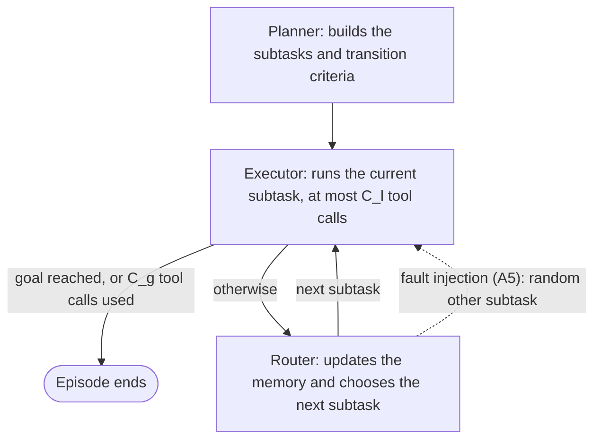

# Complete Cyclic Subtask Graphs for Tool-Using LLM Agents

**Flexibility, Cost, and Bottlenecks in Long-Horizon Workflows**

Luay Gharzeddine and Samer Saab Jr. *Transactions on Machine Learning Research*, 2026.

[](https://openreview.net/forum?id=FAkarhXCfI) [OpenReview](https://openreview.net/forum?id=FAkarhXCfI) · [PDF](https://openreview.net/pdf?id=FAkarhXCfI)

Long-horizon tool-using tasks sometimes benefit from revisiting earlier subtasks, but explicit revisitation also costs routing, coordination and tokens. This repository implements complete cyclic subtask graphs: a workflow controller in which every executable subtask can transition to every other one, and a single analyzer+router chooses each transition by checking natural-language criteria. It compares task-specific (**Spec-Cyc**) and benchmark-generic (**Gen-Cyc**) cyclic graphs against **ReAct** and the dependency-directed **DepDAG** on TextCraft, ALFWorld and Finance-Agent, and includes every ablation and analysis in the paper: model-tier allocation, n-shot trajectory summaries, tool-restricted executors, fault injection, exploration, token cost and transition audits.

## How it works



A planner decomposes the task into subtasks and writes one transition criterion for every ordered pair of subtasks, self-loops included. Execution alternates segments and routing. In each segment, one subtask's executor calls tools within a local budget. After it, the router updates a structured rolling memory from the segment's trace and picks the next subtask by evaluating the criteria on the current subtask's outgoing edges. The memory is passed to the next executor as guidance. Episodes end when the environment reports success or the global tool-call budget runs out.

| Paper | Code |
|---|---|
| Planner π, Spec-Cyc π<sub>spec</sub>(O, B, D), Gen-Cyc π<sub>gen</sub>(B, D) | `ctg.graphs.planner.plan_cyclic` |
| DepDAG and DepDAG-NoRetry planner | `ctg.graphs.planner.plan_dependency` |
| Graph G = (T, E = T × T, C) | `ctg.graphs.model.CyclicGraph`, `DependencyGraph` |
| Executors α<sub>i</sub> with tool sets U<sub>i</sub> | `ctg.control.executor`, executor profiles in each `ctg.envs.<benchmark>` |
| Analyzer+router ρ: UPDATE and SELECT | `ctg.control.router` |
| Memory M<sub>m</sub> | `ctg.runs.records.Memory` |
| Candidate sets A<sub>m</sub> | `ctg.control.policies` |
| Budgets C<sub>l</sub> and C<sub>g</sub> | `ctg.config.Budgets`, defaults per benchmark |
| Fault injection (Sec. 4.3) | `ctg.control.faults` |
| ReAct | `ctg.control.react` |

## Results

Main comparison without n-shot summaries (Table 2). Generalist executors and gpt-4o-mini in every role; mean ± standard deviation over 3 seeds. TC is the mean number of tool calls on successful episodes, and STR = SR / TC.

| Benchmark | ReAct SR (%) | TC | STR | DepDAG SR (%) | TC | STR | Spec-Cyc SR (%) | TC | STR | Gen-Cyc SR (%) | TC | STR |
|---|---|---|---|---|---|---|---|---|---|---|---|---|
| TextCraft-2 | 94.3 ± 0.2 | 7.4 ± 4.3 | 12.7 | 88.0 ± 0.9 | 11.9 ± 6.7 | 7.4 | 85.2 ± 0.8 | 11.3 ± 6.5 | 7.5 | 93.9 ± 1.3 | 9.4 ± 5.6 | 10.0 |
| TextCraft-3 | 82.5 ± 2.1 | 16.0 ± 8.8 | 5.2 | 61.0 ± 3.0 | 26.3 ± 11.0 | 2.3 | 50.4 ± 2.3 | 21.6 ± 11.8 | 2.3 | 71.5 ± 1.5 | 22.1 ± 11.9 | 3.2 |
| TextCraft-4 | 45.5 ± 14.8 | 23.4 ± 8.4 | 1.9 | 36.4 ± 7.4 | 62.8 ± 22.7 | 0.6 | 15.2 ± 8.6 | 68.8 ± 20.1 | 0.2 | 36.4 ± 0.0 | 69.1 ± 15.0 | 0.5 |
| ALFWorld | 33.8 ± 0.4 | 12.9 ± 7.5 | 2.6 | 44.3 ± 2.3 | 34.7 ± 21.0 | 1.3 | 58.2 ± 4.6 | 30.2 ± 18.5 | 1.9 | 56.7 ± 3.2 | 28.7 ± 19.9 | 2.0 |
| Finance-Agent | 12.4 ± 1.3 | 3.0 ± 0.9 | 4.1 | 10.5 ± 2.7 | 3.1 ± 1.2 | 3.4 | 14.3 ± 0.0 | 5.3 ± 2.2 | 2.7 | 15.2 ± 2.7 | 6.0 ± 2.5 | 2.5 |

Robustness under control-flow fault injection (Table 3). With probability 0.5 at every segment boundary, the router's choice is replaced by a random different subtask. SRR is perturbed SR divided by nominal SR; ΔTC is the change in tool calls on successful episodes.

| Benchmark | Graph | SRR | ΔTC |
|---|---|---|---|
| TextCraft-2 | Spec-Cyc | 0.591 | +7.5 |
| TextCraft-2 | Gen-Cyc | 0.961 | +1.2 |
| TextCraft-3 | Spec-Cyc | 0.340 | +12.3 |
| TextCraft-3 | Gen-Cyc | 0.941 | +3.4 |
| TextCraft-4 | Spec-Cyc | 0.000 | n/a |
| TextCraft-4 | Gen-Cyc | 0.874 | −6.2 |
| ALFWorld | Spec-Cyc | 0.865 | −1.5 |
| ALFWorld | Gen-Cyc | 0.769 | −1.6 |

The paper and its appendix report the full role-allocation sweep, tool exposure, token cost, transition audit, model-coverage checks and failure diagnostics.

## Installation

Requires Python 3.11 or 3.12 and [uv](https://docs.astral.sh/uv/).

```bash
git clone https://github.com/luaygz/cyclic_task_graphs
cd cyclic_task_graphs
uv sync --all-extras             # or `uv sync` without ALFWorld and plotting
uv run ctg data fetch textcraft  # TextCraft's Minecraft recipe files (635 small files, into ~/.cache/ctg/textcraft/recipes)
uv run alfworld-download         # ALFWorld game files (about 2 GB, into ~/.cache/alfworld)
cp .env.example .env             # then fill in the keys you need
```

| Variable | Needed for |
|---|---|
| `OPENAI_API_KEY` | every experiment |
| `OPENROUTER_API_KEY` | the Gemini 2.5 Pro and DeepSeek-v3.1-Terminus model-coverage checks |
| `TEXTCRAFT_RECIPES` | TextCraft, if the recipes are not in `~/.cache/ctg/textcraft/recipes` |
| `ALFWORLD_DATA` | ALFWorld, if the data is not in `~/.cache/alfworld` |
| `SEC_API_KEY`, `SERPAPI_API_KEY`, `SEC_USER_AGENT` | Finance-Agent: EDGAR full-text search via [sec-api.io](https://sec-api.io), Google search via [SerpAPI](https://serpapi.com), and the contact User-Agent that SEC asks automated clients to send |
| `CTG_SPEND_CAP_OPENAI_USD`, `CTG_SPEND_CAP_OPENROUTER_USD` | optional cumulative spend caps, checked before every model call |

## Quickstart

Run one TextCraft-2 episode with a Gen-Cyc graph, capped at ten cents:

```bash
uv run ctg run configs/experiments/a1_main/a1_textcraft2_gen_cyc.yaml --limit 1 --max-cost-usd 0.10
```

```
16:23:46  a1_textcraft2_gen_cyc: 1 episodes to run (0 of 609 already complete), concurrency 8
16:23:55  a1_textcraft2_gen_cyc: planned the Gen-Cyc graph (4 subtasks)
16:24:07  [1/1] r0 acacia_boat: won (k=5, 2 segments, $0.0016)
a1_textcraft2_gen_cyc: 1/1 episodes finished (1 won, 0 errors), $0.0027 spent
  1/609 episodes of the experiment are complete (runs/a1_textcraft2_gen_cyc)
```

The Gen-Cyc graph is planned once per experiment and reused for all 609 episodes (203 test instances × 3 seeds). Running the command again without `--limit` resumes the rest.

Each episode is saved as JSON under `runs/<experiment>/episodes/`. The file holds the graph, every segment's tool calls and observations, the router's memory and decisions, every transition, the environment trajectory, and every model call with its token counts and cost. Summarize a run with:

```bash
uv run ctg analyze summary runs/a1_textcraft2_gen_cyc
```

## Reproducing the experiments

Every experiment cell is a YAML file under `configs/experiments/`, one directory per family. `ctg run` accepts any number of them and resumes each from its run directory, so an interrupted sweep continues where it stopped. Check a sweep before paying for it:

```bash
uv run ctg run configs/experiments/a1_main/*.yaml --dry-run
```

A dry run validates every config, resolves the instance lists and checks the required keys and data, then prints the number of episodes and a rough cost estimate without calling any model. `--limit N` runs only the first N pending episodes, and `--max-cost-usd X` stops starting new episodes once the run directory has spent X, counted across invocations; deleting the directory starts a new run with a fresh cap. A Finance-Agent search service that can no longer serve the run (credits used up, API key rejected) stops it the same way: the affected episode is recorded as an error, not a loss, and rerunning the command after fixing the account resumes the run. A spend cap or an unavailable service also leaves the remaining configs of the sweep unstarted, while a Gen-Cyc graph whose planning fails stops only its own run. An episode whose model output stays unusable after the client's retries is recorded as a loss and is not rerun.

A run directory resumes only under the conditions it was created with: the same config (apart from `concurrency`), n-shot file contents, model settings and decoding settings of each role (prices may change), budgets, and record format version. Only one `ctg run` process can use a run directory at a time.

| Family | Configs | Paper | Episodes | Rough cost (dry-run estimate) |
|---|---|---|---|---|
| A1 main comparison: ReAct, DepDAG, Spec-Cyc, Gen-Cyc without n-shot | `a1_main/` | Table 2 | 5,580 | ~$160 |
| DepDAG-NoRetry | `d1_depdag_noretry/` | Table 13 | 1,395 | ~$45 |
| A2/A3 planner/executor/router allocations with n-shot summaries | `a2_a3_roles_nshot/` | Fig. 2, Tables 15 and 19 | 14,352 | ~$645 |
| A4 tool-restricted specialist executors | `a4_tools/` | Tables 16 and 20 | 5,958 | ~$225 |
| A5 fault injection | `a5_faults/` | Tables 3, 17 and 18 | 4,356 | ~$130 |
| A6 ALFWorld exploration (30-game subsample) | `a6_exploration/` | Fig. 4 | 270 | ~$8 |
| Finance-Agent model coverage via OpenRouter | `b5_model_coverage/` | Tables 9–11 | 280 | ~$6 plus OpenRouter |
| C token-cost baselines: ReAct with gpt-5-mini, compared with the P/E/R = 4o/5m/5m cyclic runs | `c_token_cost/` | Table 12 | 1,395 | ~$50 |

The A2/A3, A4 and A5 families use n-shot summaries of successful training trajectories (Sec. 4.1.6). Build them once per benchmark before running those families: run Spec-Cyc on the training split, then summarize its successful episodes. TextCraft-4 has no training split and uses the TextCraft-3 summaries.

```bash
uv run ctg run configs/nshot/nshot_textcraft2_train.yaml
uv run ctg nshot build runs/nshot_textcraft2_train --out data/nshot/textcraft_depth2.json
# likewise nshot_textcraft3_train -> textcraft_depth3.json, nshot_alfworld_train -> alfworld_train.json,
# nshot_finance_train -> finance_agent.json
```

Train/test splits are frozen in `data/splits/` (seed 42; Appendix B.2). `uv run ctg splits freeze` regenerates them.

## Analysis

`ctg analyze` turns run directories into the paper's tables (Markdown on stdout; `--csv PATH` also writes CSV).

| Command | Produces |
|---|---|
| `ctg analyze main runs/a1_*` | Table 2: SR, TC and STR by benchmark and controller |
| `ctg analyze sweep runs/a2_*` | Tables 15/16 and 19/20: SR, TC, STR, ATS/AUS/ASR and unique transitions per configuration |
| `ctg analyze robustness --nominal runs/a2_textcraft2_gen_cyc_p4o_e4o_r4o --perturbed runs/a5_textcraft2_gen_cyc_generalist` | Tables 3/17/18: SRR and ΔTC. The nominal run is the a2 run (generalist executors) or a4 run (specialists) with the same graph, models and n-shot set as the a5 run; any other pairing is refused |
| `ctg analyze tokens --baseline runs/c_textcraft2_react_e5m --compare runs/a2_textcraft2_spec_cyc_p4o_e5m_r5m` | Table 12: shared-win token comparison against a ReAct baseline (`runs/a1_*_react` for gpt-4o-mini, `runs/c_*_react_e5m` for gpt-5-mini); `--compare` repeats |
| `ctg analyze audit RUN...` | Table 14: DepDAG transition audit |
| `ctg analyze routing RUN...` | Tables 21–24: graph size and routing behavior |
| `ctg analyze failures RUN...` | Tables 10–11: Finance-Agent tool use and failure modes |
| `ctg analyze wilson RUN...` | Table 9: Wilson 95% intervals |
| `ctg analyze exploration --cyclic RUN --react RUN` | A6: unique environment states, cyclic minus ReAct |
| `ctg analyze summary RUN...` | every metric of each run |
| `ctg analyze figures RUN... --out DIR` | Figs. 2–4 (needs the `plots` extra) |

Episodes that ended in an infrastructure error are left out of every rate and listed in a note; episodes whose model output stayed unusable count as losses. A run is complete when every episode its config schedules (repeats × instances) has a non-error record. Every table and figure names incomplete runs with their finished/scheduled episode counts and incomplete repeats, and SR's mean ± std uses only complete repeats (a run without one shows its pooled rate with the std as D/A). Spend includes the earlier error attempts of episodes re-run on resume.

## Repository layout

```
configs/models.yaml          model presets (provider, reasoning effort, prices for the spend ledger)
configs/experiments/         one YAML per experiment cell, grouped by family
configs/nshot/               training-split runs that produce the n-shot summaries
data/splits/                 frozen train/test instance lists
data/textcraft/              pinned source and SHA-256 digests of the TextCraft recipe files
data/finance_agent/          Finance-Agent public validation set
src/ctg/graphs/              graph models and the planner
src/ctg/control/             executor, analyzer+router, candidate sets, fault injection, ReAct
src/ctg/envs/                TextCraft, ALFWorld and Finance-Agent environments and tools
src/ctg/llm/                 OpenAI/OpenRouter client and spend ledger
src/ctg/runs/                experiment runner, run records, splits, n-shot builder
src/ctg/analysis/            metrics, tables and figures
src/ctg/prompts/             every prompt template, as Markdown
tests/                       offline test suite (`uv run pytest`)
```

## Citation

```bibtex
@article{gharzeddine2026cyclic,
  title   = {Complete Cyclic Subtask Graphs for Tool-Using {LLM} Agents: Flexibility, Cost, and Bottlenecks in Long-Horizon Workflows},
  author  = {Gharzeddine, Luay and Saab Jr, Samer},
  journal = {Transactions on Machine Learning Research},
  year    = {2026},
  url     = {https://openreview.net/forum?id=FAkarhXCfI}
}
```

## License

MIT (see `LICENSE`). TextCraft, ALFWorld, the Finance Agent Benchmark data and the Minecraft recipe data keep their own terms; see `THIRD_PARTY_NOTICES.md`.
